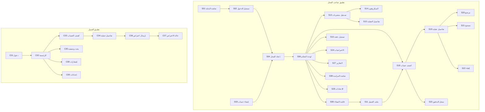

# WIZANO | وزانو — خريطة الشاشات

| البند | القيمة |
|---|---|
| رقم الوثيقة | WZ-SCR-001 |
| الإصدار | 1.0 (مسودة) |
| المرحلة | المرحلة 1 |
| ملاحظة | خريطة تحليلية فقط — **لا يُبني أي من هذه الشاشات في المرحلة 1** |

---

## 1. تطبيق صاحب المحل (Shop App)

> عدد الشاشات مقصود ومحدود: كل شاشة موجودة لأن مواصفات المشروع طلبتها.
> «مرحلة التنفيذ» = المرحلة التي تكتمل فيها الشاشة ووظائفها؛ قد يُبنى نموذج مبسّط مبكرًا إن احتاجه اختبار مرحلة سابقة (مثل شاشة دخول بسيطة في المرحلة 4).

### 1.1 الدخول والإعداد الأولي

| # | الشاشة | الغرض | مرحلة التنفيذ |
|---|---|---|---|
| S01 | شاشة البداية (Splash) | تحميل + فحص الجلسة والاتصال | 6 |
| S02 | تسجيل الدخول | بريد/هاتف + كلمة مرور | 4 |
| S03 | إنشاء حساب | تسجيل مستخدم جديد | 4 |
| S04 | إعداد ملف المحل | الاسم، العملة (افتراضيًا YER)، المنطقة الزمنية، تاريخ الافتتاح | 5 |
| S05 | الملف الشخصي للمستخدم | بيانات الحساب + الخروج | 5 |

### 1.2 الرئيسية والتنقل

| # | الشاشة | الغرض | مرحلة التنفيذ |
|---|---|---|---|
| S06 | لوحة التحكم | ملخص: مستحقات اليوم، إجمالي الديون، آخر العمليات، حالة المزامنة | 6 |
| S07 | شريط التنقل الرئيسي | الانتقال بين الأقسام | 6 |
| S08 | شاشة المزامنة | الطابور، الناجح، المتعثر (يحتاج تدخل)، آخر مزامنة | 13-14 |

### 1.3 العملاء

| # | الشاشة | الغرض | مرحلة التنفيذ |
|---|---|---|---|
| S09 | قائمة العملاء + بحث | عرض وتصفية وبحث | 7 |
| S10 | إضافة/تعديل عميل | بيانات غير مالية فقط | 7 |
| S11 | ملف العميل | بياناته + رصيده المحسوب + عملياته | 7 |
| S12 | ربط العميل بالمحل | ربط داخلي أو عبر رمز دعوة | 7 |

### 1.4 المشتريات والمدفوعات

| # | الشاشة | الغرض | مرحلة التنفيذ |
|---|---|---|---|
| S13 | تسجيل مشتريات (نموذج) | عميل، تفاصيل نصية، إجمالي، مدفوع، متبقي تلقائي، ملاحظات | 8 |
| S14 | زر الميكروفون في S13 | تسجيل صوتي → نص قابل للتعديل | 12 |
| S14b | تنزيل نموذج التعرّف على الصوت | تنزيل/حذف النموذج المحلي مع التقدّم | 12 |
| S15 | تفاصيل العملية بعد الحفظ | رقم العملية، القيم، الحالتان (مزامنة/اعتماد) | 8 |
| S16 | تسجيل دفعة | مبلغ، تاريخ، طريقة، العميل، مرجع | 9 |
| S17 | سجل المدفوعات | قائمة الدفوعات + بحث | 9 |

### 1.5 كشف الحساب والعمليات المالية

| # | الشاشة | الغرض | مرحلة التنفيذ |
|---|---|---|---|
| S18 | كشف حساب العميل | كل العمليات زمنيًا + الرصيد بعد كل عملية + فلترة | 10 |
| S19 | تفاصيل أي عملية | القيم، المصدر، الحالة، الأثر على الرصيد | 10 |
| S20 | تسجيل مرتجع | مرتبط بعملية أصلية | 11 |
| S21 | تسجيل تصحيح مالي | مبلغ + سبب إلزامي | 11 |
| S22 | إلغاء عملية | قيد عكسي موثق | 11 |
| S23 | سجل التدقيق | من/متى/ماذا/قبل-بعد | 11 |

### 1.6 الاعتراضات والتقارير والإعدادات

| # | الشاشة | الغرض | مرحلة التنفيذ |
|---|---|---|---|
| S24 | قائمة الاعتراضات + الفلترة | اعتراضات واردة وحالاتها | 15 |
| S25 | تفاصيل الاعتراض + الرد | رد موثق وتغيير الحالة | 15 |
| S26 | التنبيهات | إشعارات داخل التطبيق | 15 |
| S27 | التقارير | مشتريات/مدفوعات/أرصدة + بحث وتصفية | 15 |
| S28 | الإعدادات | الحساب، تنزيل نموذج الصوت، اللغة، الخروج | 6 (جزئي) / 12 |

**خارج الخريطة:** لا شاشات إضافية (مونتاج، رسوم بيانية زخرفية، متجر، دردشة).

---

## 2. تطبيق العميل (Customer App) — للتنفيذ في المراحل 17-19

| # | الشاشة | الغرض |
|---|---|---|
| C01 | تسجيل الدخول | بأمان، دون ميكروفون |
| C02 | الرئيسية | اسم العميل + اختيار المحل (عند الارتباط بأكثر من محل) + **المبلغ المتبقي الأبرز** + إجمالي المشتريات والمدفوعات + آخر العمليات |
| C03 | كشف الحساب | ترتيب زمني + أثر كل عملية على الرصيد + تفاصيل |
| C04 | تفاصيل العملية | التاريخ، رقم العملية، الوصف، القيمة، الأثر |
| C05 | البحث والتصفية | حسب التاريخ ونوع العملية |
| C06 | إرسال اعتراض | على عملية محددة |
| C07 | حالة الاعتراض | الحالة + الردود + وقت آخر مزامنة |
| C08 | الإشعارات | عند توفرها |
| C09 | الإعدادات/الحساب | بيانات الحساب، وقت آخر مزامنة، حالة الاتصال، الخروج |

**ممنوع وجوده في تطبيق العميل:** أي شاشة إدارة، ميكروفون، نموذج مشتريات، إدارة عملاء، إدارة محلات.

---

## 3. مخطط التصفح العام (تصوري)

---

## 4. حالات الواجهة الموحدة (لكل شاشة)

| الحالة | السلوك |
|---|---|
| تحميل | مؤشر تحميل واضح + نص |
| فراغ | رسالة + إجراء مباشر (مثال: «لا عملاء بعد — أضف عميلًا») |
| خطأ | رسالة خطأ مفهومة + زر إعادة المحاولة |
| محلي غير متزامن | وسم مرئي صريح (وليس وسم الاعتماد) |
| معتمد مركزيًا | وسم مختلف وغير قابل للخلط |
| تعذّر الصوت | رسالة + عرض الإدخال اليدوي |
