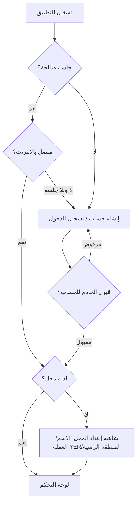
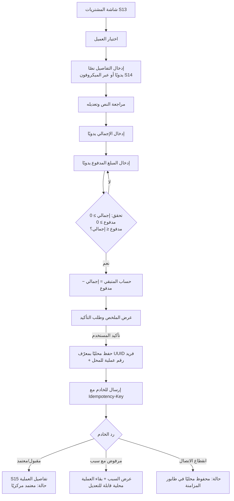
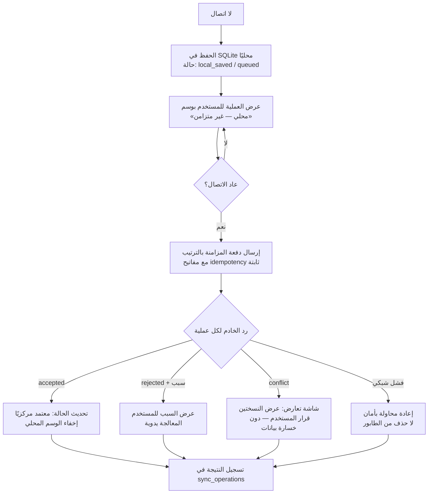
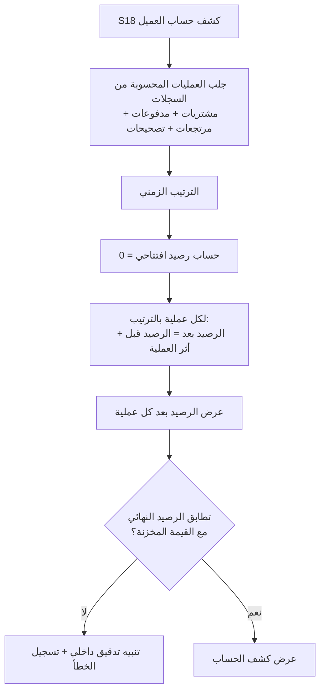
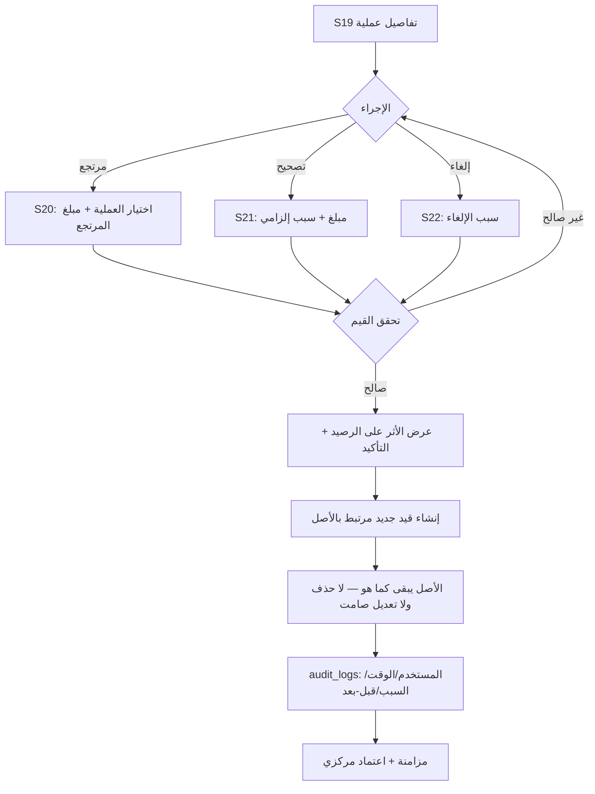
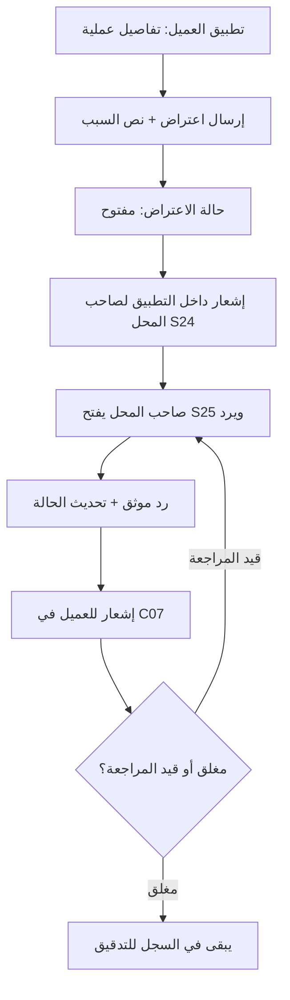
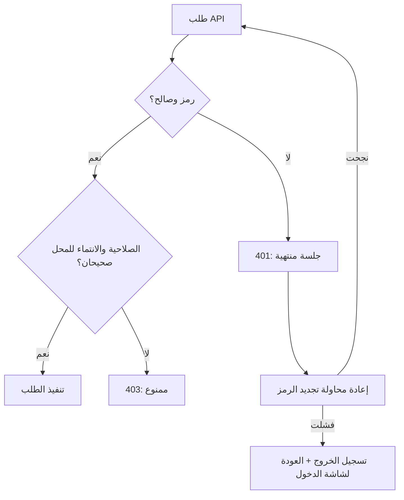

# WIZANO | وزانو — مخططات تدفق الاستخدام

| البند | القيمة |
|---|---|
| رقم الوثيقة | WZ-FLW-001 |
| الإصدار | 1.0 (مسودة) |
| المرحلة | المرحلة 1 |
| ملاحظة | مخططات تحليلية — التنفيذ في المراحل المذكورة لكل مسار |

---

## 1. أول تشغيل: حساب ← محل



**قاعدة:** لا يُسمح بالعمل دون اتصال قبل نجاح تسجيل الدخول الأولي وحفظ الجلسة.

---

## 2. تسجيل مشتريات — الوضع المتصل



**قواعد:**
- لا تحويل تلقائي من نص الأصناف إلى أسعار.
- لا تأكيد مالي دون تأكيد المستخدم صراحة.
- رقم العملية فريد **ضمن المحل**، والمعرّف فريد عالميًا.

---

## 3. تسجيل مشتريات — الوضع غير المتصل ثم المزامنة



**ضمانات:** تكرار الإرسال لا يكرر العملية؛ العملية المكررة تعيد نفس النتيجة.

---

## 4. تسجيل دفعة

```mermaid
flowchart TD
    A[ملف العميل / S16] --> B[إدخال المبلغ + التاريخ + الطريقة]
    B --> C{تحقق: المبلغ أكبر من صفر ومنطقي؟}
    C -- لا --> B
    C -- نعم --> D[عرض: الرصيد قبل الدفعة<br/>والمتوقع بعد الدفعة]
    D --> E[تأكيد المستخدم]
    E --> F[قيد دفعة جديد مرتبط بالعميل والمحل]
    F --> G[قيد مستقل لا يعدّل قيمة المشتريات القديمة]
    G --> H[الرصيد بعد الدفعة = الرصيد قبل − المبلغ]
    H --> I[مزامنة (المتصل أو الطابور)]
```

---

## 5. حساب كشف الحساب والرصيد



**أثر العملية على الرصيد:**

| النوع | الأثر |
|---|---|
| مشتريات | + الإجمالي |
| دفعة | − المبلغ |
| مرتجع | − المبلغ |
| تصحيح موجب | + المبلغ |
| تصحيح سالب | − المبلغ |
| إلغاء عملية | − أثر تلك العملية |

---

## 6. مرتجع / تصحيح / إلغاء (مع تدقيق)



---

## 7. اعتراض العميل ومعالجته



**قاعدة:** الاعتراض لا يغيّر أرقامًا مالية تلقائيًا؛ أي تعديل مالي نتيجة اعتراض = إجراء تصحيح مستقل موثق بموافقة المالك.

---

## 8. انتهاء الجلسة / المصادقة



---

## 9. ملخص نقاط الاتصال بين المكونات

| المسار | المتجه | الغرض |
|---|---|---|
| `POST /api/v1/auth/*` | التطبيقان ← الخادم | تسجيل/دخول/تجديد/خروج |
| `POST/GET /api/v1/shops*` | صاحب المحل ← الخادم | الملف والإعدادات |
| `GET/POST/PATCH /api/v1/customers*` | صاحب المحل ← الخادم | العملاء والربط |
| `POST/GET /api/v1/purchases*` | صاحب المحل ← الخادم | المشتريات (مع Idempotency-Key) |
| `POST/GET /api/v1/payments*` | صاحب المحل ← الخادم | المدفوعات |
| `POST /api/v1/returns` و`adjustments` و`cancellations` | صاحب المحل ← الخادم | القيود المصححة |
| `GET /api/v1/statements/:customerId` | كلا التطبيقين ← الخادم | كشف الحساب |
| `POST/GET /api/v1/objections*` | العميل ← الخادم | الاعتراضات والردود |
| `GET /api/v1/sync/push` و`pull` | تطبيق صاحب المحل ← الخادم | المزامنة |
| `GET /api/v1/notifications` | كلا التطبيقين ← الخادم | الإشعارات الداخلية |
| `GET /api/v1/reports/*` | صاحب المحل ← الخادم | التقارير |

> أسماء المسارات تقريبية وتُثبَّت في المرحلة 2/4 مع توثيق OpenAPI عند الحاجة.
