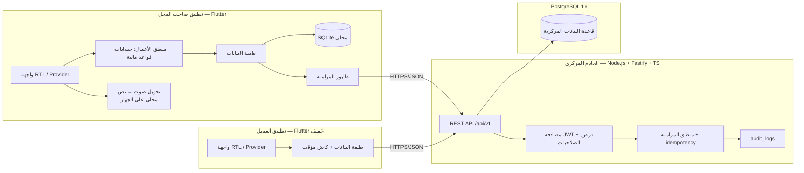

# WIZANO | وزانو — التصور المعماري

| البند | القيمة |
|---|---|
| رقم الوثيقة | WZ-ARCH-001 |
| الإصدار | 1.0 (مسودة) |
| المرحلة | المرحلة 1 |

---

## 1. المكونات



**قواعد الملكية:**

| البيانات | المالك | ملاحظة |
|---|---|---|
| العمليات المالية المعتمدة | الخادم (PostgreSQL) | المرجع الوحيد |
| نسخة العمل دون اتصال | التطبيق (SQLite) | مؤقتة وقابلة للتباعد |
| كلمة المرور/الأسرار | الخادم فقط | لا تدخل كود التطبيق |
| نموذج الصوت | جهاز المستخدم | لا يُرفع لأي خدمة |

---

## 2. التقنيات المعتمدة (موافقة صاحب المشروع في المرحلة 1)

| المكوّن | التقنية | سبب الاختيار |
|---|---|---|
| تطبيق صاحب المحل | Flutter 3.35.3 + Dart 3.9.2 + **Provider** | متوفر وموافق عليه ومعتمد في مشاريعك |
| قاعدة محلية | SQLite عبر `sqflite` | متوفر ومثبت في مشاريعك |
| تطبيق العميل | Flutter + Provider (اعتماديات أقل) | خفة + نفس اللغة |
| الخادم | **Node.js 24 + Fastify + TypeScript** | موافق عليه ومطابق لخبرة `stayflow` |
| ORM/ترحيلات | Drizzle ORM + drizzle-kit | خبرة موجودة فعلًا في مشروع `stayflow` |
| قاعدة البيانات | PostgreSQL 16.15 (خدمة مثبّتة وتعمل) | متاح فعليًا |
| تحقق المدخلات | Zod | موحد للـ API |
| تجزئة كلمات المرور | argon2id (`@node-rs/argon2`) | موجود في بيئة مشاريعك |
| المصادقة | JWT: رمز وصول قصير + رمز تجديد بتدوير | بسيط وقابلاً للإبطال |
| اختبارات الخادم | Vitest + supertest | متوافق مع المنظومة |
| اختبارات التطبيق | `flutter_test` | مدمج |
| العملة الافتراضية | **ريال يمني (YER)** لكل محل جديد | موافق عليه |

**بدائل مرفوضة حاليًا:** PHP/Laravel (غير مثبّت في البيئة — قرار D-01)، Docker (غير متوفر، لا نحتاجه للتطوير).

---

## 3. بنية تطبيق صاحب المحل (فصل الطبقات)

```
lib/
  main.dart
  app/                 # التهيئة، الثيمات، RTL، المسارات
  core/                # أخطاء، نتائج، ثوابت، أدوات، قواعد تحقق مشتركة
  domain/              # كيانات وقواعد أعمال نقية (بلا اعتماديات Flutter)
    entities/          # Purchase, Payment, Customer, Balance...
    usecases/          # حساب المتبقي، الرصيد، التحقق من القيود
  data/
    local/             # SQLite: DAO، مخطط، طابور المزامنة
    remote/            # عميل API، نماذج JSON، معالجة الأخطاء
    repositories/      # تنفيذ الواجهات (مزامن/غير متزامن)
  features/
    auth/ shop/ customers/ purchases/ payments/
    statement/ returns/ objections/ reports/ sync/ settings/
      presentation/    # شاشات + واجهات حالة (loading/empty/error)
      application/     # ChangeNotifier لكل ميزة
  sync/                # محرك المزامنة، idempotency، حل التعارضات
```

- `domain` لا يعرف Flutter → اختبارات وحدات سريعة للقواعد المالية.
- كل شاشة مرتبطة بـ ChangeNotifier واحد، والحالة تُبنى من المستودعات لا من الشاشة.
- منطق الأعمال لا يُكتب داخل الواجهة إطلاقًا.

---

## 4. بنية الخادم

```
server/
  src/
    server.ts          # نقطة التشغيل
    app.ts             # تهيئة Fastify + CORS + helmet + rate-limit
    config/            # قراءة البيئة (.env) — لا أسرار في الكود
    db/                # drizzle schema، ترحيلات، اتصال
    modules/
      auth/ shops/ customers/ purchases/ payments/
      returns/ adjustments/ objections/ statements/
      sync/ notifications/ reports/ audit/
        routes.ts      # مسارات الوحدة
        service.ts     # منطق الأعمال + الصلاحيات
        schemas.ts     # Zod validation
        service.test.ts
    middleware/        # المصادقة، التحقق من الدور والانتماء للمحل
    common/            # أخطاء موحدة، pagination، logging (pino)
  tests/               # اختبارات تكامل (API + PostgreSQL)
```

**اتفاقيات API:**

| البند | الاتفاق |
|---|---|
| النمط | REST تحت `/api/v1`، JSON فقط |
| المصادقة | `Authorization: Bearer <access>` |
| منع التكرار | ترويسة `Idempotency-Key` على كل عملية مالية |
| أكواد الخطأ | `{ error: { code, message_ar, details? } }` |
| الترقيم | `?page=&limit=` أو `cursor=` للسحب |
| الاستجابة | `{ data, meta? }` |
| اللغة | رسائل خطأ عربية |
| السجلات | pino — **بلا كلمات مرور أو رموز** |

---

## 5. بروتوكول المزامنة (تصوري — يُثبَّت في المرحلة 14)

1. **المعرّف:** العميل يولّد UUIDv7 لكل عملية قبل الحفظ.
2. **الدفع (push):** دفعات صغيرة مرتبة زمنيًا، كل عملية بـ `Idempotency-Key` ثابت.
3. **الاستجابة لكل عملية على حدة:** `accepted` | `rejected+سبب` | `conflict` (دفعة جزئية ناجحة مقبولة).
4. **السحب (pull):** `cursor` زمني لتحديث نسخة المحل/العملاء من الخادم.
5. **الخادم:** يتحقق (المصادقة → الصلاحية → الانتماء → الصحة → التكرار) ثم يخزّن ويسجّل في `sync_operations`.
6. **التكرار:** نفس `Idempotency-Key` + نفس المعرّف = نفس النتيجة بلا عملية جديدة.
7. **التعارض:** تعديل مالي متعارض → حالة `conflict` مع عرض النسختين؛ لا دمج صامت.
8. **الحالة للمستخدم:** كل عملية تعرض بوضوح: محلي/مرسل/معتمد/مرفوض/تعارض.

---

## 6. المصادقة والصلاحيات

> **حالة التنفيذ:** مُنفَّذ في المرحلة 4 (تفصيله في `08-auth-api.md`). مسارات `/api/v1/auth/*` و`/api/v1/me`، ووسيط `authenticate` + `requireShopMembership` + `requirePermission`.

- تسجيل: بريد أو هاتف + كلمة مرور → تجزئة **argon2id** على الخادم.
- الجلسة: `access` (~15 دقيقة) + `refresh` مع تدوير وقائمة سوداء عند الاستخدام.
- التخزين في التطبيق: `flutter_secure_storage` (لا SharedPreferences للرموز).
- كل مسار حساس: مصادقة → تحقق الدور → تحقق `shop_id` من الرمز **لا من الطلب** → تحقق الصلاحية.
- عزل المحلات: كل استعلام مالي مُقيَّد بـ `shop_id` المستخرج من الرمز، ويُختبر عزله باختبارات صريحة.

---

## 7. العمل دون اتصال (بنية عامة)

| الطبقة | المسؤولية |
|---|---|
| SQLite | مصدر الحفظ الأول لكل عملية |
| `pending_queue` | كل عملية غير معتمدة، مرتّبة، بمعرّف وحالة |
| محرك المزامنة | يرسل، يعيد المحاولة، يحدّث الحالات، يسجّل النتائج |
| طبقة العرض | وسوم حالة واضحة: «محلي» ≠ «معتمد» |
| التعافي | عند الإقلاع: فحص الطابور + الحالات العالقة |

تُطلب تحديثات البيانات من الخادم فقط عند توفر الاتصال.

---

## 8. الإشعارات (المرحلة 15)

- **المصدر الأساسي:** إشعارات داخل التطبيق (مستقلة عن خدمات خارجية).
- الإرسال عبر FCM عند توفر البنية والأجهزة — **تُقيَّم لاحقًا** ولا تُعد شرطًا (قد تُجهز Google Play Services).
- **إشعارات الهاتف ليست مصدرًا للرصيد**؛ مصدر الرصيد: سجلات الخادم المعتمدة.

---

## 9. تحويل الصوت إلى نص (المرحلة 12 — قرار معلّق)

- معالجة محلية 100% بعد تنزيل النموذج.
- **مرشحون غير معتمدين بعد** (التقييم في المرحلة 12 قبل أي اختيار):
  - `sherpa-onnx` (دعم نماذج عربية، عمل دون اتصال)
  - `speech_to_text` / حزم Flutter حول خدمة النظام (`SpeechRecognizer`) — **تعتمد على خدمات Google وقد لا تعمل دون اتصال**
- **معايير التقييم:** دقة العربية واللهجة اليمنية، حجم النموذج، زمن التحويل، العمل دون اتصال، حجم أثر APK، الأجهزة المستهدفة.
- لا يُثبَّت أي حزمة ولا يُدَّعى دعمها قبل الاختبار الفعلي على جهاز.

---

## 10. بيئة التطوير

| البند | القيمة |
|---|---|
| النظام | Windows + PowerShell |
| Flutter | 3.35.3 stable / Dart 3.9.2 |
| Node | 24.15 / npm 11.12 (**يُستدعى عبر `npm.cmd`** — `npm.ps1` مرفوض بسياسة التنفيذ) |
| PostgreSQL | 16.15 — خدمة `postgresql-x64-16` تعمل؛ `psql` في `C:\Program Files\PostgreSQL\16\bin` |
| Java / Android SDK | 17 و SDK في `%LOCALAPPDATA%\Android\Sdk` |
| Git | 2.55 متوفر (إنشاء مستودع في المرحلة 2) |
| Docker / PHP | غير متوفران — غير مطلوبان بالخطة المعتمدة |
